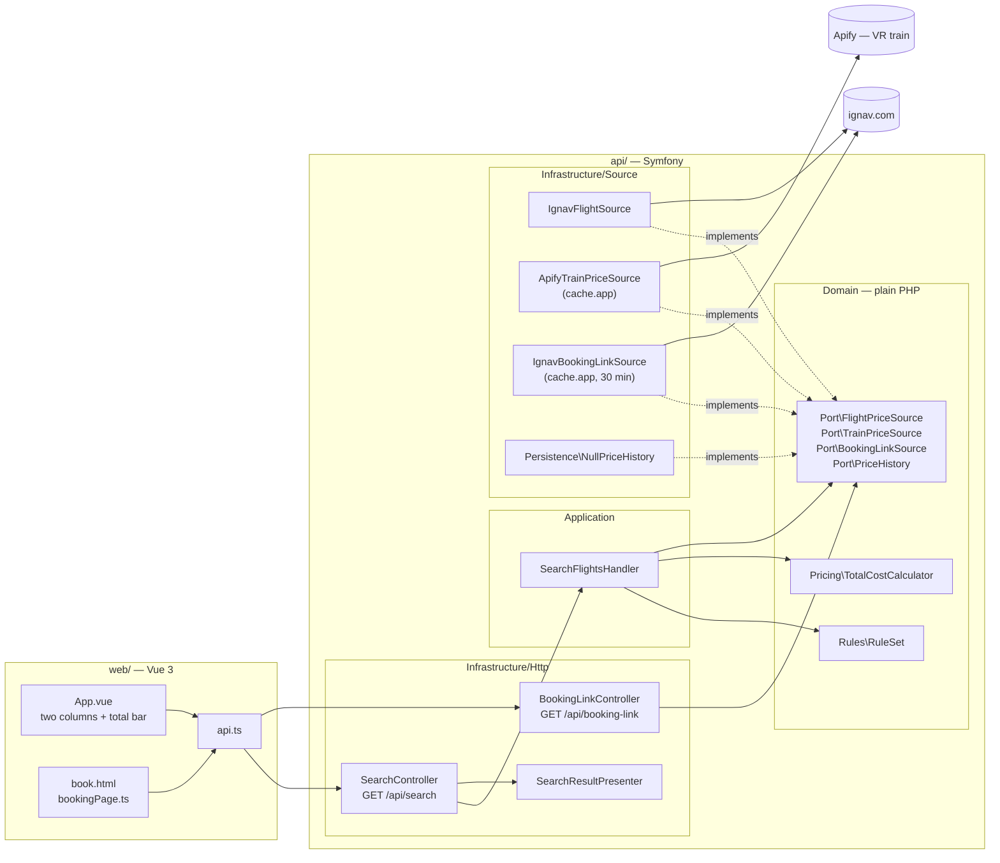
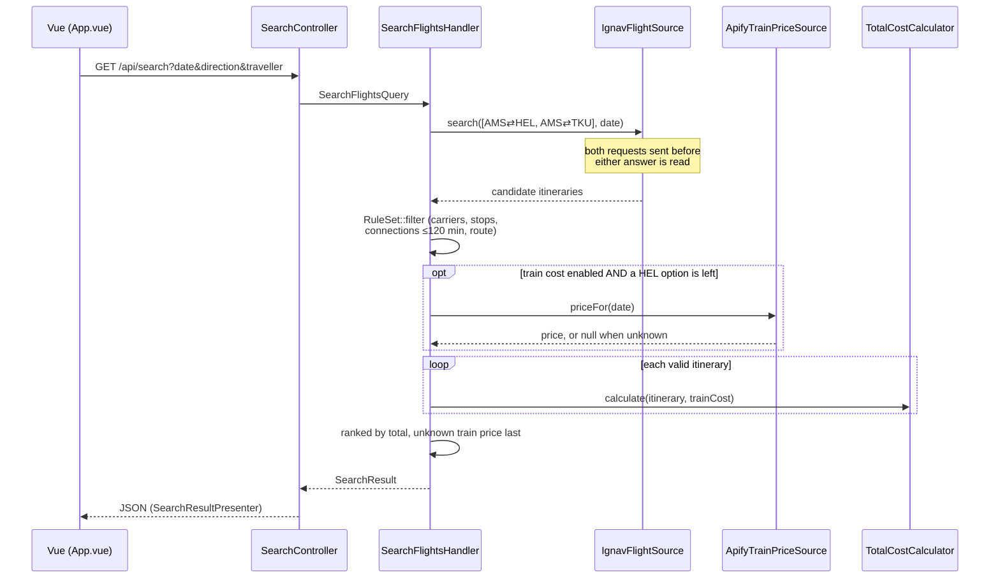

# Architecture

A Vue SPA talks to a small Symfony API. The API has no database: every search
asks the external sources live, applies the travel rules and computes a total.
Lasting decisions are in [`adr/`](adr/); deployment is in
[`deployment.md`](deployment.md).

## Components

The arrows are dependencies. Infrastructure implements the domain's ports;
the domain imports nothing from Symfony (`tests/Architecture/DomainPurityTest.php`).

## Main flow: one search

One call to `/api/search` covers one direction on one date. A round trip is two
calls from the frontend ([ADR-0001](adr/0001-round-trip-as-two-one-way-trips-in-the-frontend.md)).

Errors: invalid input → 400, `FlightSourceUnavailable` (e.g. a missing or
rejected `IGNAV_API_KEY`) → 503. The booking link (`GET /api/booking-link?ref=…`)
is fetched only when someone clicks "Book"
([ADR-0006](adr/0006-booking-link-on-demand.md)); a failure there is a 502.
