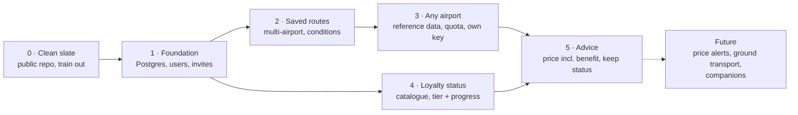
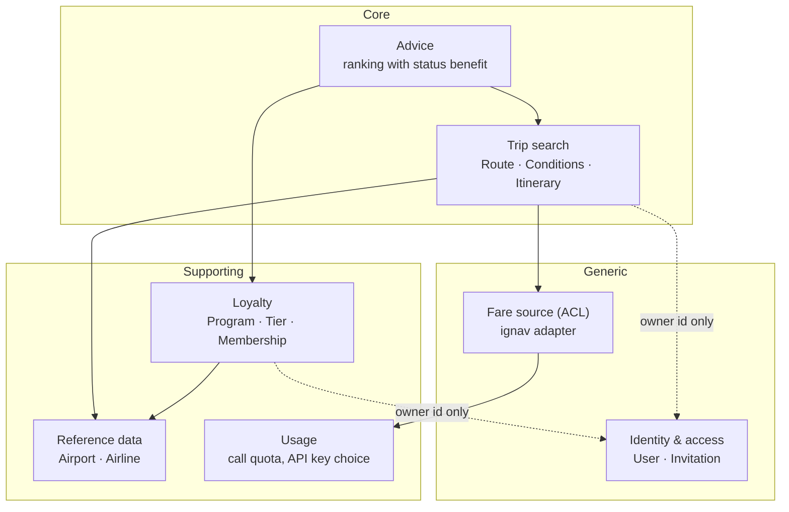

# Roadmap: General flight finder

Decisions behind this roadmap: [`00-status.md`](00-status.md).
Every phase leaves a working app; Leiden ⇄ Turku keeps working the whole way,
first as code, from phase 2 on as a saved route.
Each phase becomes its own feature folder in `docs/plans/` and goes through
the four gates (product, architecture, program design, slices) before code.

## Phases at a glance

Phases 3 and 4 do not depend on each other; their order can still swap.

## Bounded contexts

Dependencies point from supporting to core, and the core only knows a user
as an id: login, passwords and invitations never enter the search model.

## Phase 0 — Clean slate (small, now)

Goal: the repo can go public and contains no Leiden ⇄ Turku code that is
already known to go.

- Merge the MIT license; switch the repo to public on GitHub.
- Remove the HEL ⇄ TKU train: `TrainPriceSource`, `ApifyTrainPriceSource`,
  `TRAIN_COST_ENABLED`, `trainCostKnown`/`trainCostIncluded` in API and UI.
  New ADR that supersedes ADR-0004.
- New ADR: *General flight finder*: the scope widens, the stack choices
  "no database" and "no commands" end. Update the "Stack choices" section of
  AGENTS.md to point to it.
- Pick up the existing work items first or alongside:
  [`debuggability/`](../debuggability/00-status.md) (request id, structured
  logs: needed before there are users) and
  [`behat-feature-tests/`](../behat-feature-tests/00-status.md).

## Phase 1 — Foundation: database and users

Goal: invited people can log in; the search they see is still Leiden ⇄ Turku.

- PostgreSQL in `compose.yaml`, `compose.prod.yaml` and the smoke test;
  Doctrine ORM with mapping in `Infrastructure/Persistence`; migrations
  run on deploy (`scripts/deploy.sh`).
- `User` (email, password hash, role admin/user), `Invitation` (token,
  expiry, invited by). Admin invites by email; the invitee sets a password.
- Login, logout, password reset (Symfony Security + Mailer). The SPA talks
  to the API with a session cookie (same origin, so no tokens needed).
- Replaces the nginx basic auth on production.
- Self-host: first version of `docs/self-hosting.md` (compose, env, first
  admin via a console command).

Decisions for this phase (ADRs): how writes are structured (plain handlers
called by the controller, or Symfony Messenger as a command bus); mail
transport on the VPS; session vs. token auth for the SPA.

## Phase 2 — Saved routes with conditions

Goal: every user keeps their own routes; Leiden ⇄ Turku is no longer code but
the first saved route of the owner.

- `Route`: name, origin airports, destination airports (max 3 per side),
  owner. Search runs one call per origin × destination pair.
- `Conditions`: airlines allow/deny, connection count, min/max connection
  time, allowed/forbidden connection airports, time window per direction,
  trip form. Account defaults plus per-route overrides.
- The existing rule classes (`AllowedCarriers`, `MaxConnectionDuration`,
  `HelsinkiTimeWindow`, `RequiredStopCount`, …) get their values from the
  route instead of from config; `HelsinkiTimeWindow` becomes a general time
  window.
- "Booked with the airline" stays a hard filter on the fare source.
- UI: route list, route editor, search a route with one click (pick dates).
- Data migration: the current hardcoded rules become the owner's route.
- Call quota per user (counted calls per month) arrives here, because this
  is the first phase where several people spend the admin's credits.

## Phase 3 — Any airport

Goal: you can build a route from any airport and airline in the world.

- `Airport` and `Carrier` stop being enums with five and three cases; they
  become value objects (IATA code) backed by reference data.
- Reference data: an airport/airline dataset imported by a console command.
  Candidate sources and their licences are a decision of this phase.
- Airport picker with search; the UI shows up front how many calls a search
  costs.
- Own ignav key per user, stored encrypted; the admin's key is the fallback.
- Check what ignav covers outside AY/SK/KL before promising "any airline".

## Phase 4 — Loyalty status

Goal: each user records their status, and the app knows what it is worth.

- Catalogue of programs (start: EuroBonus, Finnair Plus, Flying Blue) with
  their tiers and the benefits per tier (hand baggage, checked baggage).
  Maintained as data in the repo, extendable.
- `Membership`: user, program, tier, progress (points or levels), qualifying
  period end date. Entered by the user.
- UI: "my status" page.

Open for this phase: do benefits apply per program or per alliance
(SkyTeam Elite, oneworld Ruby/Sapphire)? Does the catalogue stay fixed or can
a user add a program?

## Phase 5 — Advice

Goal: the result list says which option is best *for you*, and why.

- **Price including status benefit.** Baggage costs come back: a new ADR
  that supersedes ADR-0005. The old `BaggagePolicy`/`FareUpgradeRates` ideas
  (spec of phase 1) are the starting point, now fed by the catalogue.
- **Keeping your status.** "You need X more until <date>; this airline
  counts towards it." Based on the progress the user entered, no computed
  points per flight.
- The rule from phase 1 still applies: no invented amounts; an unknown
  benefit is shown as unknown, never as €0.

Open: a money-versus-status trade-off ("€40 more, but you reach Gold") needs
an estimate of points per flight. Not decided.

## Future (not planned)

- **Price alerts** for dates you already know: "time to book", "special
  offer". Needs a scheduler, stored observations (`PriceHistory` port
  exists), and mail or push.
- Ground transport to and from airports (the train, but general).
- Travelling together: companions, advice for a group.
- Locale and multiple languages (UI in English, formatting nl-NL for now).
- Serious self-hosting: public images, semver, upgrade notes.

## Risks that steer the order

- **API credits.** 1,000 free ignav requests/month. Multi-airport routes
  multiply calls; quota comes in phase 2, own keys in phase 3.
- **Coverage of the fare source.** ignav works for AY/SK/KL around AMS/HEL;
  the SAS price is already wrong (`sas-price-unknown/`). "Any airport" may
  need a second source.
- **Personal data.** Users, emails and loyalty numbers make this an app that
  stores personal data; the small invite-only circle keeps that manageable.
</content>
</invoke>
<invoke name="Bash">
<parameter name="command">cd /Storage/Workspace/Projecten/flights && perl -0pi -e 's/(# Handoff — flight finder\n\n)/$1## 00. Next: general flight finder (1 Nov 2026)\n\nThe owner wants to turn this into a general, open source flight finder:\nany airport, saved routes with conditions, users by invitation, loyalty\nstatus and advice. Intake decisions and the phased roadmap:\n[`general-flight-finder\/`](general-flight-finder\/00-status.md). Nothing built yet.\n\n---\n\n/' docs/plans/README.md && head -12 docs/plans/README.md && docker run --rm -v "$PWD/docs/plans/general-flight-finder:/d:ro" minlag/mermaid-cli:11.4.2 --version 2>&1 | tail -1